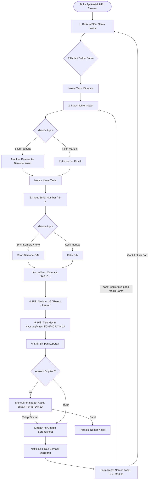

# Panduan & Alur Penggunaan Dashboard Laporan Kaset Rusak Alsut

Dokumen ini berisi panduan lengkap mengenai alur (*workflow*), fitur-fitur utama, dan tata cara penggunaan aplikasi **Laporan Kaset Alsut** untuk seluruh personil operasional di lapangan maupun tim CPC (*Cash Processing Center*) / CCAS.

---

## 📌 Ringkasan Aplikasi

Aplikasi **Laporan Kaset Alsut** adalah platform web *mobile-friendly* (PWA) berkecepatan tinggi yang dirancang khusus untuk mempermudah pencatatan kaset ATM/CRM yang mengalami kerusakan atau masalah saat proses *replenish* di lokasi mesin.

### Keunggulan Utama Sistem:
1. **Bebas Hambatan Login**: Tim lapangan dapat langsung membuka aplikasi tanpa perlu login akun Google.
2. **Scanner Kamera Native**: Mendukung pemindaian langsung barcode batang (1D) dan QR Code (2D) dengan reticle presisi dan fitur senter (*flashlight*).
3. **Autocomplete WSID & Lokasi Otomatis**: Cukup ketik kode WSID, nama lokasi otomatis terisi dari master data 1.741 ATM.
4. **Cepat & Tahan 50+ Pengguna Bersamaan**: Menggunakan arsitektur *Micro-Lock* dan Vercel Serverless Function, mencegah data bentrok atau tumpang tindih (*zero row collision*).
5. **Form Cerdas (*Sticky State*)**: Nilai WSID, Lokasi, dan Tipe Mesin otomatis diingat sehingga input kaset ke-2, ke-3, dan seterusnya pada mesin yang sama menjadi jauh lebih cepat.
6. **Integritas Kolom Terjaga**: Hanya mengisi kolom A sampai G (PKT), membiarkan kolom H dan I tetap kosong untuk diverifikasi oleh tim CPC/CCAS.

---

## 🔄 Diagram Alur Kerja (Workflow)

---

## 📱 Panduan Langkah Demi Langkah Penggunaan

### Langkah 1: Membuka Aplikasi
1. Buka tautan resmi aplikasi di browser smartphone Anda (Google Chrome di Android, Safari di iPhone):
   **`https://laporan-kaset-rusak.vercel.app/`**
2. **Rekomendasi (Pasang ke Layar Utama HP)**:
   - **Android (Chrome)**: Ketuk menu titik tiga (⋮) di pojok kanan atas > pilih **"Tambahkan ke Layar Utama"** (*Add to Home screen*).
   - **iPhone (Safari)**: Ketuk tombol Share (kotak panah ke atas) > pilih **"Add to Home Screen"**.
   - *Aplikasi akan terpasang dengan ikon kaset dan dapat dibuka fullscreen tanpa address bar browser.*

---

### Langkah 2: Memilih WSID & Lokasi Otomatis
1. Ketuk kolom **WSID**.
2. Ketik kode WSID (misalnya: `Z005`, `Z006`, atau `Z025`) atau ketik nama lokasi (misal: `Alam Sutera`, `Serpong`).
3. Kotak saran (*suggestions dropdown*) akan langsung muncul di bawah kolom:
   - Pilih kode WSID yang sesuai dari daftar saran.
4. **Kolom Lokasi akan langsung terisi otomatis** sesuai master data WSID (contoh: `Z005` langsung mengisi `Bumi Serpong Damai`).
5. *Catatan: WSID dan Lokasi akan terus tersimpan di HP Anda hingga Anda berpindah ke mesin ATM berikutnya.*

---

### Langkah 3: Tanggal Replenish
- Kolom **Tanggal Replenish** otomatis terisi tanggal hari ini (WIB / Asia-Jakarta).
- Kolom ini bersifat *read-only* untuk menjamin konsistensi data waktu pelaporan.

---

### Langkah 4: Input Nomor Kaset (Barcode Alsut)
Anda dapat memasukkan Nomor Kaset dengan dua cara:
- **Cara A (Scan Kamera Barcode)**:
  1. Ketuk tombol kamera (**📷**) di sebelah kanan kolom Nomor Kaset.
  2. Saat pertama kali, pilih **"Izinkan" (Allow)** pada permohonan izin kamera.
  3. Arahkan garis laser merah ke barcode stiker kaset hingga berbunyi/bergetar. Nomor kaset akan otomatis masuk ke form dan scanner menutup sendiri.
- **Cara B (Ketik Manual)**:
  - Ketik langsung nomor kaset pada kolom yang tersedia (contoh: `WCR2063`).

---

### Langkah 5: Input S/N (Serial Number Kaset)
1. Anda dapat mengetik manual atau menekan tombol kamera (**📷**) pada kolom S/N.
2. **Fitur Cerdas Normalisasi S/N**:
   - Jika Anda mengetik nomor `153994` atau memindai barcode bawaan kaset, sistem secara otomatis menstandardisasi formatnya menjadi **`SAB10153994`** saat keluar dari field.
   - Jika format S/N tidak lazim, sistem akan memberikan tanda peringatan kuning untuk memastikan Anda tidak salah ketik.

---

### Langkah 6: Memilih Module
1. Ketuk dropdown **Module**.
2. Pilih salah satu posisi module kaset:
   - **1**, **2**, **3**, **4**, **5** (sesuai slot kaset pada mesin)
   - **Reject** (kaset tampungan uang reject)
   - **Retract** (kaset tampungan uang retract/kembali)

---

### Langkah 7: Memilih Type Mesin
1. Ketuk dropdown **Type Mesin**.
2. Pilih jenis mesin ATM/CRM tempat kaset berada:
   - **Hyosung**
   - **Hitachi**
   - **OKI**
   - **NCR**
   - **YIHUA**
3. *Tipe mesin yang Anda pilih akan otomatis tersimpan untuk kaset-kaset berikutnya pada sesi tersebut.*

---

### Langkah 8: Melampirkan 2 Foto Bukti Kaset Rusak (Wajib)
Sistem mewajibkan melampirkan 2 foto bukti yang akan otomatis dimasukkan langsung ke dalam sel spreadsheet dengan ukuran standar presisi **9,25 cm x 12,31 cm** (350 × 465 px HD Retina, ukuran file ringan ~35–48 KB):

1. **Foto 1: Result Test Cash (Layar ATM Error Code / Fatal Cassette)**:
   - **Objek yang difoto**: Layar monitor mesin ATM yang menampilkan kode error atau status fatal cassette (*Bukan foto struk kertas*).
   - **Metode**: Ketuk **"Buka Kamera"** untuk memotret langsung atau **"Pilih Galeri"** untuk memilih foto dari galeri HP.
   - **Mode Skala Default**: **Mode: Fit (Utuh)**. Mode ini mempertahankan 100% tampilan layar monitor ATM tanpa ada kode error di sudut/tepi layar yang terpotong.

2. **Foto 2: Label Kaset Bad (Posisi di Modul)**:
   - **Objek yang difoto**: Fisik kaset dan stiker label posisi kaset di dalam modul mesin ATM.
   - **Mode Skala Default**: **Mode: Crop (Penuh)**. Foto kaset akan mengisi seluruh sel secara simetris edge-to-edge tanpa celah.

3. **Fitur Cerdas pada Pratinjau Foto**:
   - **🔄 Tombol Putar 90° (Rotate)**: Jika foto diambil dalam posisi miring atau horizontal, ketuk tombol *"Putar 90°"* untuk memutar orientasi foto 90°, 180°, atau 270° secara langsung.
   - **📐/✂️ Mode Skala Cerdas (Center-Fit vs Center-Crop)**: Anda dapat mengubah mode perataan gambar kapan saja hanya dengan sekali ketuk.
   - **🏷️ Penamaan File Otomatis & Terstruktur**:
     Sistem secara otomatis memberi nama file terstruktur sesuai WSID dan Nomor Kaset:
     - `RESULT_TEST_[WSID]_[NOKASET]_[DATE].jpg`
     - `LABEL_MODUL_[WSID]_[NOKASET]_[DATE].jpg`
     *(Contoh: `RESULT_TEST_Z006_WCR2063_20261023_153000.jpg`). Nama ini juga disematkan pada Catatan Sel (Note) dan Alt-Text di spreadsheet.*

---

### Langkah 9: Menyimpan Laporan
1. Periksa kembali kelengkapan data form dan kedua foto kaset, lalu ketuk tombol biru **"Simpan Laporan"**.
2. **Deteksi Duplikat Otomatis**:
   - Jika nomor kaset tersebut sudah pernah dilaporkan sebelumnya, sistem akan memunculkan jendela konfirmasi:
     > *"Nomor kaset WCR2063 sudah pernah dilaporkan pada tanggal 22 Okt 2026 untuk WSID Z005. Tetap simpan laporan ini?"*
   - Jika memang kaset dilaporkan ulang, ketuk **"Ya, Tetap Simpan"**.
   - Jika salah ketik nomor kaset, ketuk **"Batal"** dan koreksi nomor kaset Anda.
3. Setelah penyimpanan berhasil:
   - Muncul notifikasi hijau: **"Laporan Berhasil Disimpan"**.
   - Kolom **Nomor Kaset**, **S/N**, **Module**, serta **kedua foto** langsung di-reset bersih siap untuk kaset berikutnya.
   - Kolom **WSID**, **Lokasi**, dan **Type Mesin** **tetap dipertahankan**.
   - Kursor otomatis fokus ke kolom Nomor Kaset, siap untuk input kaset ke-2 dan seterusnya!

---

## 🎯 Panduan Fitur Pemindai Barcode (Scanner)

Jendela pemindai barcode dilengkapi fitur khusus untuk mempermudah scan pada berbagai kondisi stiker kaset di lapangan:

| Fitur | Fungsi & Cara Pakai |
|---|---|
| **Mode 1D (Barcode Batang)** | Tombol `📏 Barcode Batang (1D)`. Bingkai pemindai berbentuk horizontal memanjang, dioptimalkan khusus untuk membaca barcode garis-garis tipis kaset. |
| **Mode 2D (QR Code)** | Tombol `🔲 QR Code (2D)`. Bingkai pemindai berbentuk kotak persegi untuk stiker berbentuk QR. |
| **Senter / Torch (⚡)** | Tombol senter di pojok kanan atas pemindai. Sangat berguna saat posisi kaset berada di bagian bawah brankas atau ruangan mesin ATM yang redup. |
| **Ambil Foto Barcode (📸)** | Tombol cadangan di bagian bawah. Jika barcode tergores, miring, atau sulit ditangkap video live, ketuk tombol ini untuk memotret stiker kaset langsung. Sistem memiliki **fitur auto-rotasi cerdas (90°, 180°, 270°)** untuk mendeteksi barcode yang terbalik. |

> [!TIP]
> **Tips Memindai Barcode Batang (1D):**
> Pastikan garis laser merah memotong **seluruh garis hitam barcode secara tegak lurus** dari ujung kiri ke ujung kanan. Jika stiker barcode pada kaset terpasang tegak lurus (vertikal), cukup miringkan smartphone Anda 90°.

---

## 📊 Integrasi Data ke Google Spreadsheet

Data yang dikirimkan oleh tim lapangan akan langsung masuk ke spreadsheet master:

- **Sheet Target**: `"Format Laporan Kaset Rusak"`
- **Kolom Teks (Diisi Otomatis oleh Aplikasi / Tim PKT)**:
  - **WSID**: Kode WSID mesin ATM.
  - **Lokasi**: Lokasi mesin ATM (otomatis sesuai master WSID).
  - **Tanggal Replenish**: Format tanggal Indonesia: `d mmm yyyy`.
  - **Nomor Kaset**: Nomor barcode Alsut kaset.
  - **S/N Kaset**: Serial number kaset (standar `SAB10...`).
  - **Module**: Nomor modul (1–5, Reject, Retract).
  - **Type Mesin**: Merk mesin ATM (Hyosung, Hitachi, OKI, dll.).
- **Kolom Foto Kaset (Presisi 9,25 cm × 12,31 cm / 350 × 465 px)**:
  - **Foto Result Test Cash**: Foto layar monitor ATM error code/fatal kaset.
  - **Foto Label Kaset Bad Posisi di Modul**: Foto fisik kaset & posisi stiker label bad di modul.
  - *Dilengkapi nama file terstruktur dan catatan sel (Cell Note) saat sel disorot kursor.*
- **Kolom Tim CPC / CCAS**:
  - `Cek CPC Alsut` *(Tidak disentuh oleh aplikasi lapangan)*
  - `Tgl Bongkaran` *(Tidak disentuh oleh aplikasi lapangan)*

---

## ❓ Tanya Jawab & Kendala Operasional (FAQ)

### 1. Bagaimana jika ada 50 personil lapangan submit laporan di waktu bersamaan?
Aplikasi telah dilengkapi arsitektur antrean atomik (*Micro-Lock*) dan serverless Vercel dengan *5x retry exponential backoff*. Tidak akan ada data yang hilang, tertimpa, atau loncat baris. Setiap laporan akan dicatat berurutan dengan durasi pemrosesan kurang dari 1 detik.

### 2. Apa yang harus dilakukan jika kamera blank hitam atau tidak bisa terbuka?
- Pastikan izin kamera pada browser telah diatur ke **"Izinkan" / "Allow"**.
- Tutup aplikasi kamera lain yang sedang berjalan di latar belakang HP.
- Jika kamera live tetap dibatasi oleh sistem operasi HP, gunakan tombol **"Ambil Foto Barcode"** di dalam modal scanner untuk memotret langsung barcode kaset.

### 3. Jika berpindah ke lokasi ATM baru, apakah harus menghapus form satu per satu?
Tidak perlu. Cukup ketik kode WSID baru di kolom WSID, maka Lokasi akan otomatis terupdate. Atau Anda dapat mengetuk tombol abu-abu **"Reset Form"** di bawah tombol Simpan untuk membersihkan seluruh isian form sekaligus.

---

*Dokumen ini diperbarui secara berkala sesuai versi terbaru aplikasi Dashboard Laporan Kaset Alsut.*
